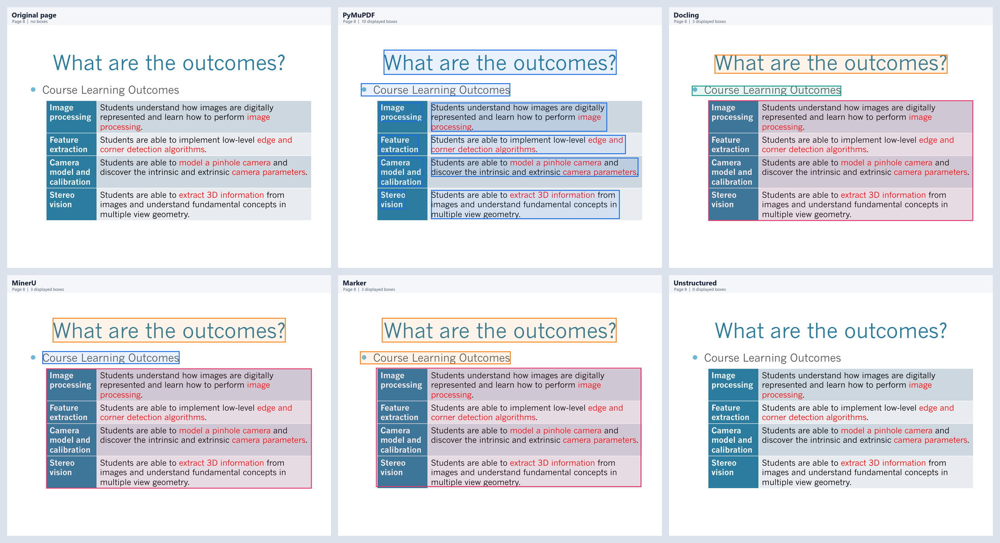
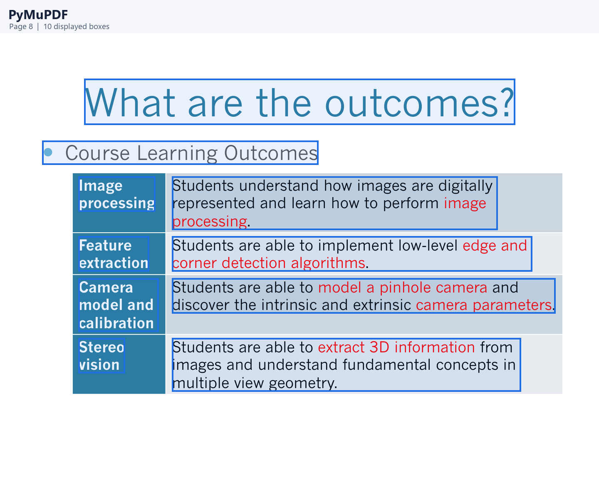
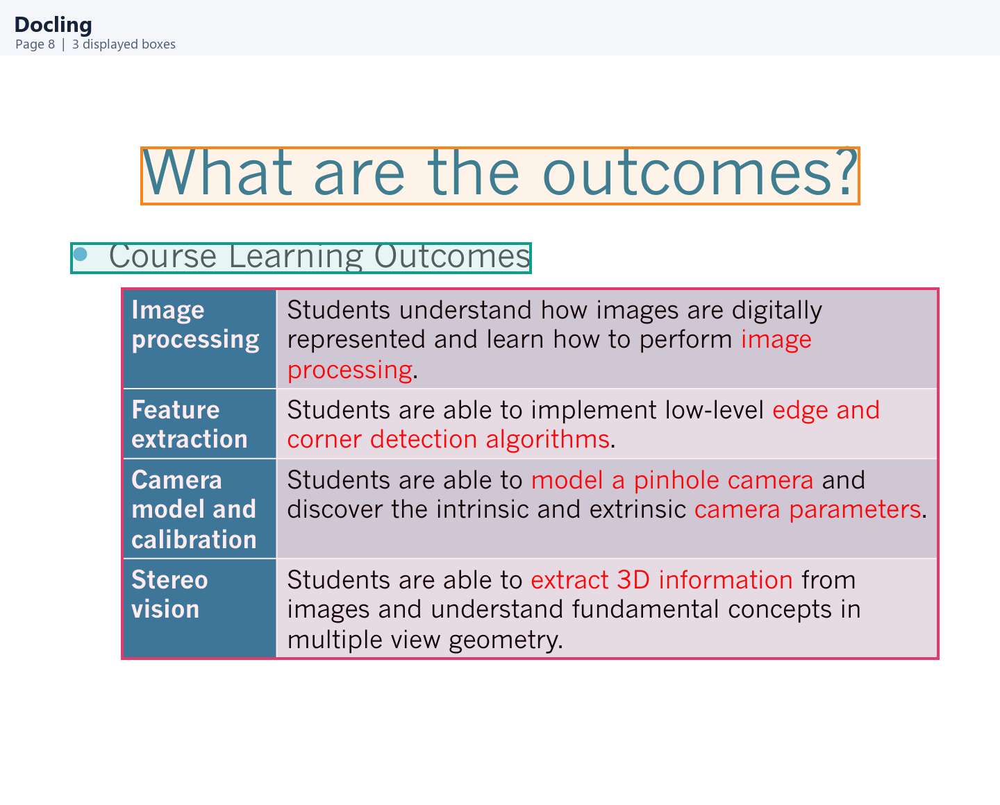
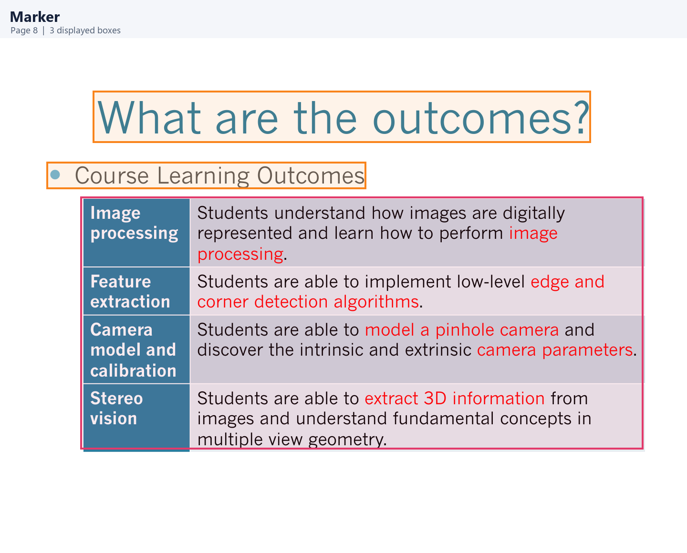
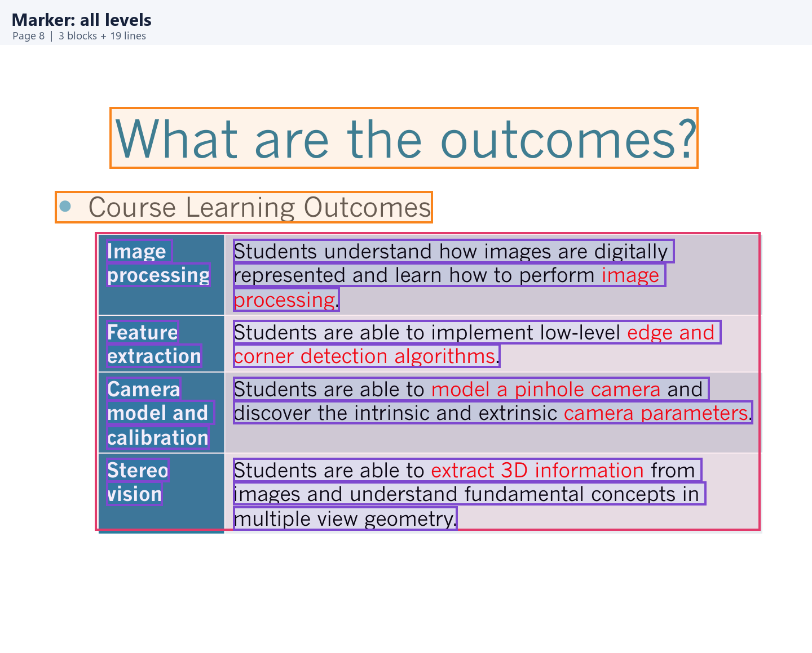
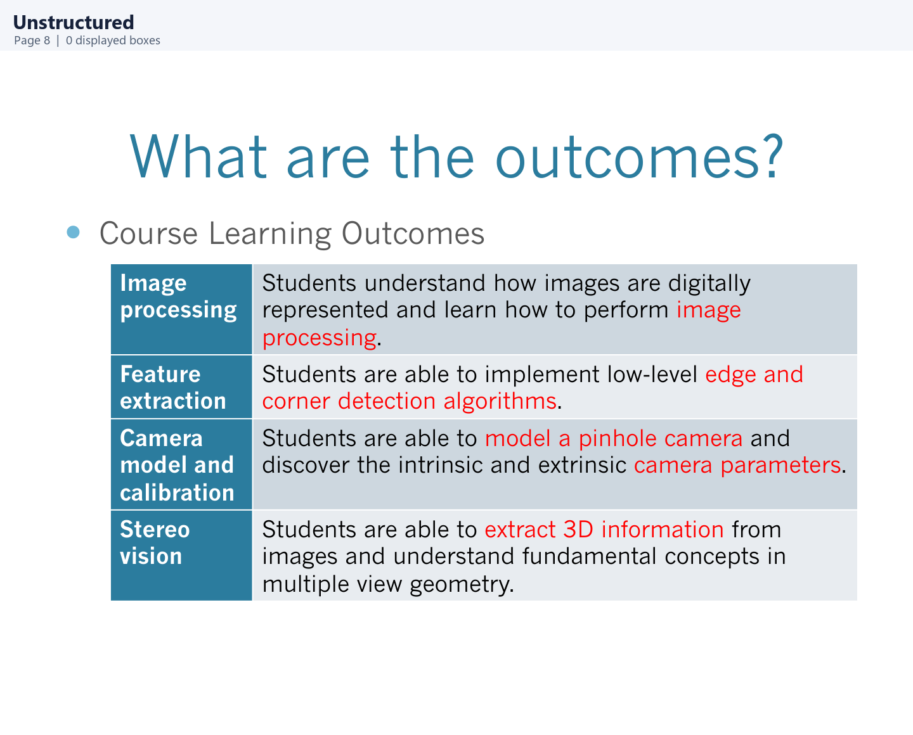

# 五种 PDF 解析器：同一页的 JSON 与框选效果

这份对照使用[原始 PDF](../backend/storage/cee0be7be61840938cb4e0bf04b2ae8c/original.pdf) 的**第 8 页**（PDF 页码从 1 开始；多数 JSON 的 `page_index` 是 `7`）。该页有标题、项目符号、跨行文字和一张 **4 行 × 2 列**的表格，适合观察“文字块”和“表格块”的差异。页面尺寸是 **720 × 540**。

> **如何读图：**所有彩框都是把项目的 `normalized.json` 坐标叠加到同一张原 PDF 页面上，模拟前端默认的 `block` 级别显示。下方代码块则摘自各工具的 **`raw.json`**，只保留与例子有关的字段；部分长文本与坐标小数已缩短，完整值请点各节的原始 JSON 链接。橙色＝标题，蓝色＝普通文字，青绿色＝列表项，粉色＝表格，紫色＝Marker 的行级文字。



| 解析器 | 第 8 页原始结构 | 前端默认显示 | 表格在 JSON 中的样子 |
| --- | --- | ---: | --- |
| PyMuPDF | `pages[7].blocks`，每块是 7 项数组 | 10 个文字框 | 没有 `table` 对象；表格里的 8 个单元格各有文字框 |
| Docling | `texts`、`tables` 等顶层数组，元素带 `prov` | 2 个文字/标题框 + 1 个整表框 | `tables` 中有 4 行、2 列、8 个 `table_cells` |
| MinerU | `pages[7].blocks`，每块含 `type/content/bbox` | 2 个文字/标题框 + 1 个整表框 | `table` 块的 `content` 内含 HTML 表格 |
| Marker | `children` 页面树，表格含子节点 | 2 个标题框 + 1 个整表框 | `Table` 节点下有 19 个 `Line` 子节点 |
| Unstructured | `elements` | 0 个框 | 本次返回空数组，无法观察其正常元素结构 |

## 1. PyMuPDF：按文字布局切块

第 8 页的 `raw.json` 在 `pages[7].blocks` 中有 10 个数组。下面这个数组对应表格左上角的 **Image processing**；第 5 项的 `\n` 是这个框中的换行，不代表另一个框。

```json
[
  94.19992065429688,
  171.90597534179688,
  186.53811645507812,
  214.5479736328125,
  "Image \nprocessing\n",
  2,
  0
]
```

数组顺序是 `[x0, y0, x1, y1, text, block_no, block_type]`。本例 `block_type = 0` 表示文字。右侧长句虽然跨了三行，仍是**一个**文字框；所以“每行一个框”不是固定规则。这里的 8 个表格单元格对应 8 个文字框，却没有一个代表整张表的对象。



**对应效果：**两个页面标题框 + 8 个表格单元格文字框。项目当前调用 `get_text("blocks")`；PyMuPDF 的表格检测 API `find_tables()` 是另一项功能，未加入这份 raw JSON。查看 [完整 raw.json](../backend/storage/cee0be7be61840938cb4e0bf04b2ae8c/results/pymupdf/raw.json) / [normalized.json](../backend/storage/cee0be7be61840938cb4e0bf04b2ae8c/results/pymupdf/normalized.json)。

## 2. Docling：表格对象与单元格网格

Docling 将不同内容放在顶层的 `texts`、`pictures`、`tables` 等数组。第 8 页这张表在 `tables` 中的结构节选如下；`table_cells` 实际有 **8 项**。

```json
{
  "self_ref": "#/tables/2",
  "label": "table",
  "prov": [{
    "page_no": 8,
    "bbox": {
      "l": 87.05,
      "t": 372.76,
      "r": 676.25,
      "b": 105.20,
      "coord_origin": "BOTTOMLEFT"
    }
  }],
  "data": {
    "num_rows": 4,
    "num_cols": 2,
    "table_cells": [{
      "text": "Image processing",
      "start_row_offset_idx": 0,
      "start_col_offset_idx": 0,
      "row_span": 1,
      "col_span": 1
    }]
  }
}
```

这里 `prov.bbox` 的原点在**左下角**，所以绘图时要用页面高度 `540` 换算：`[l, 540-t, r, 540-b]`，得到约 `[87.05, 167.24, 676.25, 434.80]`。注意 Docling 的每个 `bbox` 自带 `coord_origin`；这张表内部单元格的 `bbox` 标为 `TOPLEFT`，不能对所有坐标一律翻转。



**对应效果：**标题、列表项和整张表各一个框。表格文字可在原始 `data.table_cells` 中逐格读取；目前项目的 `normalized.json` 把表格画成一个框，但该框的 `text` 是空字符串。查看 [完整 raw.json](../backend/storage/cee0be7be61840938cb4e0bf04b2ae8c/results/docling/raw.json) / [normalized.json](../backend/storage/cee0be7be61840938cb4e0bf04b2ae8c/results/docling/normalized.json)。

## 3. MinerU：比例坐标与 HTML 表格

第 8 页在 `pages[7].blocks` 中有 3 个块：`doc_title`、`text`、`table`。表格块节选如下；完整 HTML 含 4 个 `<tr>`。

```json
{
  "type": "table",
  "index": 2,
  "bbox": [0.12, 0.31, 0.94, 0.805],
  "content": [{
    "type": "table_body",
    "index": 2,
    "bbox": [0.12, 0.31, 0.94, 0.805],
    "content": "<table><tbody><tr><td>Image processing</td><td>Students understand how images are digitally represented and learn how to perform image processing.</td></tr>…</tbody></table>"
  }]
}
```

这份 MinerU 4.1.7 的 `bbox` 用 **0–1 的页面比例**。横坐标乘 `720`、纵坐标乘 `540`，表格框就变成 `[86.4, 167.4, 676.8, 434.7]`。先前前端看不到 MinerU 框，原因正是项目适配器误把这些数当作 0–1000 坐标；现已修复。


**对应效果：**标题、普通文字、整张表各一个框。表格的文本结构主要在 HTML 字符串里。查看 [完整 raw.json](../backend/storage/cee0be7be61840938cb4e0bf04b2ae8c/results/mineru/raw.json) / [normalized.json](../backend/storage/cee0be7be61840938cb4e0bf04b2ae8c/results/mineru/normalized.json)。

## 4. Marker：树状结构，表格下有文字行

Marker 的根节点有 `children`，其中 12 个页面节点对应 12 页。第 8 页的页面节点是 `children[7]`；它有两个 `SectionHeader` 和一个 `Table`。表格节点节选如下，它的 `children` 实际有 **19 个 `Line`**。

```json
{
  "id": "/page/7/Table/2",
  "block_type": "Table",
  "bbox": [83.88, 165.92, 673.95, 430.84],
  "html": "<p></p>",
  "children": [{
    "id": "/page/7/Line/10",
    "block_type": "Line",
    "html": "<b>Image </b> ",
    "bbox": [94.20, 171.91, 152.83, 193.58],
    "children": null
  }]
}
```

表格节点本身的 `html` 没有表格内容；文字位于子 `Line` 节点的 `html` 中。项目将它们扁平化到 `normalized.json`，同时保留 `level = "block"` 或 `level = "line"` 供前端筛选。

**默认 Block 级别：**只显示两个标题和一个整表框，共 3 框。



**切到全部级别：**再显示表格中的 19 个紫色行框，共 22 框。紫色框跨越各单元格内容，但不是独立的表格单元格对象。



目前项目的 `normalized.json` 中，整表框的 `text` 也是空字符串；要取该表文字需读取原始 `children` 的 `html`。查看 [完整 raw.json](../backend/storage/cee0be7be61840938cb4e0bf04b2ae8c/results/marker/raw.json) / [normalized.json](../backend/storage/cee0be7be61840938cb4e0bf04b2ae8c/results/marker/normalized.json)。

## 5. Unstructured：本次没有元素

这次解析保存下来的**完整原始 JSON** 就是：

```json
{"elements": []}
```

因此 `normalized.json` 的第 8 页 `blocks` 也是 `[]`，没有任何可画的框。下图保留原页，说明空白框选来自解析结果，而不是图片生成时漏画。



终端曾显示 NLTK 数据下载被代理安全检查阻止；在补齐数据并**重跑当前解析器**之前，这份 JSON 无法展示 Unstructured 正常情况下的 `Element` 字段，也不能用它比较识别质量。查看 [完整 raw.json](../backend/storage/cee0be7be61840938cb4e0bf04b2ae8c/results/unstructured/raw.json) / [normalized.json](../backend/storage/cee0be7be61840938cb4e0bf04b2ae8c/results/unstructured/normalized.json)。

## 原始 JSON 与页面上看到的框是什么关系？

五个解析器的原始字段、坐标原点和分组方式不同。项目先将它们统一成 `normalized.json` 的 `pages[].blocks[]`，前端再绘制 `bbox`。以 Docling 的整表框为例，页面数据中对应：

```json
{
  "id": "docling:p7:b2",
  "type": "table",
  "text": "",
  "bbox": [87.05, 167.24, 676.25, 434.8],
  "coordinate_system": "top-left",
  "level": "block",
  "source_id": "#/tables/2"
}
```

所以**框的数量和位置**说明布局识别与坐标转换的表现；**框里能取回什么内容**还要看原始 JSON 和适配器如何处理它。特别是本例的 Docling/Marker：它们识别出了整表框，但当前归一化结果的整表 `text` 为空，表格内容仍保存在各自的原始结构里。

图片可用 `llm-dev` 环境运行 `python docs/render_parser_json_comparison.py` 从现有 PDF 和 `normalized.json` 重新生成。脚本只读取已有结果，不重新运行五个解析器。
